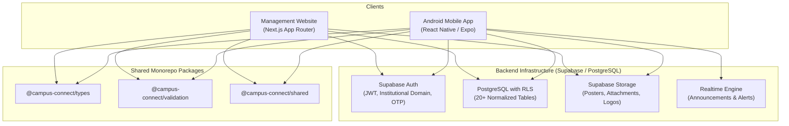

# Campus Connect — Architecture Documentation

## 1. System Overview

**Campus Connect** is an integrated Android mobile application and web-based management platform built specifically for **SRM Institute of Science and Technology, Ramapuram Campus, Chennai**.

It unifies academic announcements, club activities, event registrations, verified student identity, and personalized discovery into a single real-time ecosystem.



---

## 2. Monorepo Organization

```text
campus-connect/
├── apps/
│   ├── mobile/             # React Native (Expo Router, NativeWind, TanStack Query)
│   └── web/                # Next.js 15+ App Router, Tailwind CSS, Lucide
├── packages/
│   ├── types/              # Canonical TypeScript interfaces & enums
│   ├── validation/         # Zod schemas for forms, API payloads, & invariants
│   └── shared/             # Constants, SRM programmes, ranking algorithms, helpers
├── supabase/
│   ├── migrations/         # PostgreSQL DDL, Row Level Security policies, RPC functions
│   └── seed.sql            # Seeded demo data with strictly synthetic test accounts
├── docs/                   # Full system architecture, testing, and lifecycle documentation
├── .env.example
├── package.json
└── README.md
```

---

## 3. Core Subsystems

### 3.1 Smart Feed Engine (Hybrid, Smart, Custom)
- **Smart Mode**: Rule-based scoring engine calculating affinity based on the student's department, enrolled B.Tech programme, academic year, section, club followings, and event urgency.
- **Custom Mode**: Manual override allowing students to filter by category, followed clubs, and explicitly muted topics.
- **Hybrid Mode (Default)**: Combines deterministic recommendation weighting with user-defined preferences while guaranteeing that mandatory institutional notices are never suppressed.

### 3.2 Event Management & Concurrency-Safe RSVP
- Lifecycle: `draft` → `pending_approval` → `approved` → `published` (plus `rejected`, `cancelled`, `completed`).
- Concurrency-safe registration via PostgreSQL stored procedures checking capacity constraints and deduplication.
- Cryptographic non-predictable UUID QR passes for event check-in.
- Universal `.ics` calendar generation and deep-link exports for Google, Apple, and Outlook calendars.

### 3.3 Faculty Bulletin Hub
- Target broadcasting supporting Campus-Wide, Department-Specific, Programme-Specific, Batch-Specific, and Section-Specific scopes.
- Verification status and audit trails for all issued bulletins.
